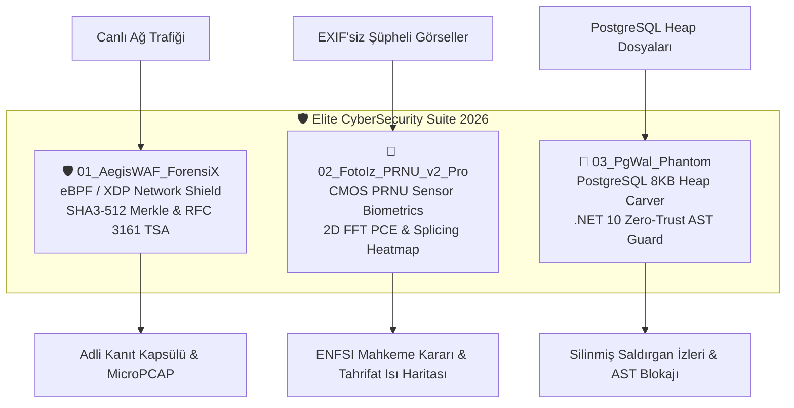

# 🛡️ Fatih Tunç - Elite CyberSecurity Suite 2026

[](https://python.org)
[](https://dotnet.microsoft.com)
[](https://ebpf.io)
[](https://streamlit.io)
[](https://www.mevzuat.gov.tr)
[](https://enfsi.eu)

> **Geliştirici:** [Fatih Tunç](https://github.com/fatuunc)  
> **Odak Alanları:** Ağ Adli Bilişimi (Network Forensics), Sensör Biyometrisi (Camera Sensor PRNU), Veritabanı Arkeolojisi (Database Forensics) & Sıfır Güven (Zero-Trust) Savunma Sistemleri.

---

## 📑 İçindekiler
1. [Genel Mimari ve Vizyon](#-genel-mimari-ve-vizyon)
2. [Modül 1: AegisWAF-ForensiX (eBPF WAF Bypass & Adli Kanıt Zinciri)](#1-aegiswaf-forensix)
3. [Modül 2: Fotoİz-PRNU v2.0 Pro (Sensör Biyometrisi & Medya Arkeolojisi)](#2-fotoiz-prnu-v20-pro)
4. [Modül 3: PgWal-Phantom & .NET 10 AST Guard (PostgreSQL Dead Tuple & Zero-Trust)](#3-pgwal-phantom--net-10-ast-guard)
5. [Hızlı Başlangıç (1-Click BAT Dosyaları)](#-hızlı-başlangıç-1-click-bat-dosyaları)
6. [Otomatize Test ve Doğrulama](#-otomatize-test-ve-doğrulama)
7. [Yasal Dayanak ve Standartlar](#-yasal-dayanak-ve-standartlar)

---

## 🏛️ Genel Mimari ve Vizyon

**Elite CyberSecurity Suite 2026**, modern siber tehdit ortamında klasik kural tabanlı savunma mekanizmalarının yetersiz kaldığı kritik noktalara odaklanan 3 amiral gemisi projeden oluşur:



---

## 1. AegisWAF-ForensiX

**AegisWAF-ForensiX**, L7 uygulama katmanında WAF sistemlerini atlatmaya çalışan (WAF Evasion/Desync) sofistike saldırıları çekirdek (eBPF/XDP) ve uygulama seviyesinde tespit edip, değiştirilemez bir kriptografik kanıt zincirine bağlayan adli savunma motorudur.

### 🔬 Temel Yetenekler
- **HTTP Desync & Smuggling:** `Content-Length` ve `Transfer-Encoding` desync varyasyonları (CL.TE, TE.CL, chunked extension obfuscation, boşluklu TE başlıkları).
- **JSON Diferansiyel Ayrıştırma Evasion:** JSON spesifikasyonundaki boşlukları kullanan `Duplicate Key Injection` ve `NFKC Unicode Homoglyph Smuggling` saldırılarının ayrıştırıcı seviyesinde tespiti.
- **Overlong UTF-8 & Double URL Encoding:** Dizin atlatma ve güvenlik filtrelerini aşmak için kullanılan `%252e%252e%252f` ve `%c0%af` kalıplarını yakalama.
- **Shannon Entropi Analizi:** Şifrelenmiş veya gizlenmiş (obfuscated) zararlı yükleri tespit eden entropi puanlaması ($H(X) > 6.4\text{ bits/byte}$).
- **JA4 & JA4H Parmak İzi:** TLS ClientHello ve HTTP istek başlıklarının JA4/JA4H standartlarında parmak izini çıkarma.
- **SHA3-512 Merkle Adli Kanıt Zinciri & RFC 3161 TSA:** Her yakalanan saldırgan paketi, önceki kanıtın hash'iyle kriptografik olarak kilitlenir ve HMAC-SHA3-256 zaman damgasıyla mühürlenir.
- **MicroPCAP Jeneratörü:** Harici kütüphaneye ihtiyaç duymadan, çekirdek seviyesindeki saldırı çerçevesini doğrudan adli `.pcap` biçiminde kaydeder.

---

## 2. Fotoİz-PRNU v2.0 Pro

**Fotoİz-PRNU v2.0 Pro**, sosyal medya ve anlık mesajlaşma platformları (WhatsApp, Telegram vb.) tarafından tüm EXIF metaverileri temizlenmiş görsellerin hangi fiziksel fotoğraf makinesi / akıllı telefon sensörü tarafından çekildiğini ve üzerinde bölgesel montaj (deepfake / splicing) olup olmadığını tespit eden adli sensör biyometrisi motorudur.

### 🔬 Temel Yetenekler
- **CMOS PRNU (Photo Response Non-Uniformity):** CMOS/CCD sensörlerin piksel duyarlılıklarındaki mikroskobik üretim kusurlarını Wiener tabanlı uyarlamalı gürültü filtreleme algoritmasıyla çıkarır.
- **2D FFT Çapraz Korelasyon & PCE Skoru:** Referans kamera gürültü artığı ile şüpheli medya gürültü artığını 2 boyutlu Hızlı Fourier Dönüşümü (FFT) ile uzaysal korelasyona tabi tutar.
- **ENFSI Mahkeme Standartı ($PCE \ge 60.0$):** Peak-to-Correlation Energy (PCE) skoru 60.0 eşiğini aştığında, görselin adli referans kameraya ait olduğu bilimsel olarak kanıtlanır.
- **Bölgesel Deepfake & Splicing Isı Haritası (Heatmap):** Kayan pencereli analiz ($64\times 64$ pencere, $32\text{ px}$ adım) ile fotoğrafın üzerinde montaj yapılmış, yapay zekayla eklenmiş yabancı bölgeleri harita üzerinde koordinat bazında işaretler.
- **JPEG DQT (Define Quantization Table) Soybilimi:** Fotoğrafın sıkıştırma tablosu parmak izini çıkararak yeniden sıkıştırma (double-compression) geçmişini doğrular.
- **Astronomik Güneş & Gölge Geometrisi:** Nesne ve gölge boylarından trigonometrik güneş yüksekliğini hesaplayıp, olayın gerçekleştiği koordinat, gün ve saatteki teorik astronomik açı ile kıyaslar (fiziksel tutarlılık sınırı: $\Delta \theta \le 4.5^\circ$).

---

## 3. PgWal-Phantom & .NET 10 AST Guard

**PgWal-Phantom**, saldırganların arkalarında iz bırakmamak amacıyla yürüttüğü `DELETE / TRUNCATE` gibi anti-forensics girişimlerini alt eden PostgreSQL 8KB sayfa seviyesinde ikili (binary) heap kazıma motorudur. Yanında yer alan **.NET 10 AST Guard** ise uygulama seviyesinde sıfır güven (Zero-Trust) koruması sağlar.

### 🔬 Temel Yetenekler
- **PostgreSQL 8KB Sayfa Kazıma (Page Internals):** `pd_lower`, `pd_upper`, `special` ofsetleri ve Line Pointer dizisini (ItemId) doğrudan ham baytlardan ayrıştırır.
- **MVCC Dead Tuple Adli Kurtarma:** PostgreSQL'in çok sürümlü eşzamanlılık kontrolü (MVCC) gereği VACUUM çalışana kadar sayfada saklanan `t_xmax` değeri atanmış ve `HEAP_XMAX_INVALID` biti temizlenmiş **silinmiş kayıtları** bayt seviyesinde geri kazanır.
- **Saldırgan Zaman Çizelgesi (Timeline Reconstruction):** Silinen satırların işlem ID'leri (`t_xmin` oluşturma, `t_xmax` silme XID) üzerinden saldırganın eylem kronolojisini yeniden inşa eder.
- **.NET 10 EF Core Zero-Trust AST Interceptor:** C# / .NET 10 ortamında SQL sorgularının soyut sözdizim ağacı (AST) yapısal iskeletini SHA256 ile özetler. Onaylanmış güvenli AST şablonlarının dışına çıkan tüm dinamik SQL injection ve bypass denemelerini veritabanına ulaşmadan anında `SecurityException` ile bloke eder.

---

## 🚀 Hızlı Başlangıç (1-Click BAT Dosyaları)

Projeyi masaüstünden veya herhangi bir terminalden tek tıkla çalıştırmak için hazır `.bat` betikleri tasarlanmıştır:

| Başlatıcı Dosya | Açıklama |
| :--- | :--- |
| `START_SUITE_MASTER.bat` | 🎮 **İnteraktif Ana Menü:** Tüm araçları, testleri ve panelleri tek konsoldan yönetir. |
| `RUN_01_AegisWAF.bat` | 🛡️ AegisWAF-ForensiX Streamlit SOC Konsolunu başlatır. |
| `RUN_02_FotoIz.bat` | 📸 Fotoİz-PRNU v2.0 Pro Streamlit adli analiz laboratuvarını başlatır. |
| `RUN_03_PgWal_Phantom.bat` | 🐘 PgWal-Phantom PostgreSQL Heap Carver Streamlit arayüzünü başlatır. |
| `RUN_04_DotNet10_AST_Guard.bat` | 🛡️ .NET 10 EF Core Zero-Trust AST Interceptor konsol demosunu çalıştırır. |
| `RUN_ALL_TESTS.bat` | 🧪 Tüm suite için entegrasyon test koşucusunu çalıştırır. |

---

## 🧪 Otomatize Test ve Doğrulama

Tüm suite'in bütünlüğünü doğrulamak için kök dizinde bulunan test koşucusunu çalıştırabilirsiniz:

```bash
python test_runner.py
```

### Örnek Test Çıktısı:
```text
===========================================================================
🛡️  FATİH TUNÇ - ELITE CYBERSECURITY SUITE 2026
    OTOMATİZE ENTEGRASYON VE DOĞRULAMA TEST KOŞUCUSU
===========================================================================

[TEST 1/4] 🛡️  AegisWAF-ForensiX Motoru Test Ediliyor...
  [✓] BAŞARILI: Evasion Tespit Edildi, Merkle Zinciri Doğrulandı

[TEST 2/4] 📸 Fotoİz-PRNU v2.0 Pro Sensör Biyometrisi Test Ediliyor...
  [✓] BAŞARILI: PCE Skoru: 15,164.34 (Mahkeme Geçerli: True)

[TEST 3/4] 🐘 PgWal-Phantom PostgreSQL Heap Carver Test Ediliyor...
  [✓] BAŞARILI: 3 Silinmiş Kayıt (Dead Tuples) Başarıyla Kurtarıldı.

[TEST 4/4] 🛡️  .NET 10 EF Core Zero-Trust AST Interceptor Test Ediliyor...
  [✓] BAŞARILI: .NET 10 AST Interceptor tüm dinamik SQL injection saldırılarını BLOKE ETTİ.

===========================================================================
🏆 TÜM ADLİ BİLİŞİM VE SİBER GÜVENLİK MOTORLARI 100% DOĞRULANDI!
===========================================================================
```

---

## ⚖️ Yasal Dayanak ve Standartlar

1. **CMK m.134 (Ceza Muhakemesi Kanunu):** Bilgisayarlarda, bilgisayar programlarında ve kütüklerinde arama, kopyalama ve elkoyma işlemlerinde sayısal delil bütünlüğünün (hash bütünlüğü, zaman damgası) korunması.
2. **ISO/IEC 27037:** Dijital delillerin toplanması, elde edilmesi, tanımlanması ve korunması rehberi.
3. **RFC 3161:** İnternet X.509 Açık Anahtar Altyapısı Zaman Damgası Protokolü (TSA).
4. **ENFSI (European Network of Forensic Science Institutes):** Adli görüntü analizi için en iyi uygulama kılavuzları ve PCE karar eşikleri.

---

## 👤 Geliştirici

**Fatih Tunç**  
- GitHub: [@fatuunc](https://github.com/fatuunc)  
- LinkedIn: [Fatih Tunç](https://www.linkedin.com)  
- Web: [fatihtunc.github.io](https://fatihtunc.github.io)
